# [BAZEL-3791](https://youtrack.jetbrains.com/issue/BAZEL-3791/Shared-Starlark-analysis) Shared analysis for Starlark - design

## 1. Summary

Starlark features currently collect similar information independently, which duplicates work and produces inconsistent handling of aliases, reassignment, and imports.
Shared scope, control flow, and value analysis should reduce duplication and improve mutation diagnostics while keeping name resolution independent of value analysis.
Delivery is split into four MRs, starting with shared scope information and variable checks, then control flow and value analysis with imports.
The final MR adjusts shared mutation checks and migrates both mutation inspections.
The analysis must preserve uncertainty, keep reused results valid after edits, and maintain editor responsiveness.
Python support inspires the design, which provides a foundation for later shared function information, member lookup, and type checking.

## 2. Context and problem

### 2.1. Existing Starlark support

The plugin provides name resolution, completion, and inspections for Starlark code.
These features need information about names, assignments, and values.
They need different levels of detail to answer different questions.

Name resolution here means finding declarations through scope rules and imports.
Navigation uses these results, and name completion uses the same lookup to list available names.
Variable inspections check whether a name is available at a location.
Mutation inspections need information about the object used at that location.
They check changes to collections during iteration and changes to frozen imported values.

Starlark uses `load` to import symbols from another `.bzl` module.
That module finishes evaluation before the importing module can use its exported values.
Lists and dictionaries from the loaded module are frozen: they can be read, but attempts to change them fail at runtime.

The following terms distinguish the information that these features need.

- **Scope** - a region of a program that owns a set of name bindings.
- **Binding** - a name owned by one logical scope. All declarations and assignments to that name in that scope share the binding.
- **Binding site** - a declaration or assignment site associated with a binding. Sites include parameters, imports, and iteration targets.
- **Current value** - The object that a read of a name can obtain at a particular program location.
- **Alias** - another name that refers to the same object.
- **Mutation** - a change to an existing object. Assigning a name to another object is a separate operation.
- **Reassignment** - an assignment that makes an existing name refer to another value.
- **Control flow** - the possible order in which program statements execute.
- **Unknown fact** - a property that the analysis cannot establish.

### 2.2. Problem statement

Features currently collect related information through separate paths.
This repeats work and gives features different rules for following assignments, aliases, and imports.

Three questions need separate answers:

1. Which scope binds this name, and where are its declarations and assignments?
2. Which assignments can supply the value at this location?
3. What do we know about the possible values, such as their kind, identity, or frozen state?

Finding a declaration does not establish the current value.
A name can keep the same binding while later assignments change the object it refers to.
Different names can also refer to the same object.

For users, these gaps can cause missed mutation warnings or warnings based on a value that a name no longer refers to.
For maintainers, each feature needs separate changes to handle the same language behavior.

### 2.3. Current approach

Name resolution collects declarations from source scopes and follows imports.
The variable inspection maintains its own records of declarations and uses, including their source order.

The iteration mutation inspection uses declaration lookup and name matching to connect an operation to a loop.
These matches do not reliably identify the iterated object after aliases or reassignment.

The frozen-value inspection follows imported names and examines the initializer at the resolved declaration.
This limits support for aliases and later assignments.

### 2.4. Representative examples

#### A declaration and the current value

```starlark
def update():
    items = ()
    items = []
    items.append(1)
```

At the call to `append`, `items` refers to a list.
Name resolution can still select the first assignment, which introduces the name.
A check of the method call needs information about the later assignment.
Reading only the initializer at the resolved declaration would describe a tuple.

#### An alias survives reassignment

```starlark
def update():
    items = [1, 2]
    alias = items
    for item in items:
        items = []
        items.append(item)
        alias.append(item)
```

The loop iterates over the original list.
Reassigning `items` makes that name refer to a new list.
The alias still refers to the original list.

Changing the new list through `items.append` is valid.
Changing the iterated list through `alias.append` is an error.
The inspection needs to follow the object shared by the alias and the loop.

#### A local name can refer to a frozen imported object

In `values.bzl`:

```starlark
items = []
```

In a file that imports the value:

```starlark
load(":values.bzl", "items")

def update():
    current = items
    current.append(1)
    current = []
    current.append(1)
```

The first call to `append` attempts to change the imported frozen list and should receive a warning.
After reassignment, `current` refers to a new local list.
The second call should receive no frozen-value warning.
The inspection needs to follow the imported object through an alias and account for the later reassignment.

### 2.5. Other potential consumers

Checks for conflicting declarations could reuse scope information while keeping their rules for module declarations and imported names.

Dictionary-key checks could identify lists or dictionaries supplied as keys through names, aliases, or imports.
Tuple keys need facts about their contents. Duplicate keys need exact values.
Unpacking checks could extend beyond literals with information about the number and structure of supplied values.
Mutable containers also need analysis of changes after initialization.

Call validation, argument completion, parameter navigation, and documentation could share function declarations and parameter information.
Recursion checks could reuse possible call targets once the analysis supports function values, while retaining their separate analysis of calls between functions.

Navigation and completion for known `struct` fields could share field lookup once the analysis provides field information.
The same information could support a future inspection for invalid member access.
A future typechecker could reuse scope and control flow analysis while adding a richer type model.

### 2.6. Why shared design?

Adding support for aliases and reassignment within each inspection would repeat the same work.
Each path would also need its own rules for branches, imports, and later source changes.
The features described above would otherwise need separate answers to the same questions.

Shared analysis should give features a consistent source of facts while keeping different questions separate.
Name resolution should use only the information it needs.
Checks that depend on the current value should request further analysis when necessary.
A shared design also lets features reuse completed work.
It gives one place to maintain rules for result validity and analysis cost as more features adopt it.

## 3. Outcomes and goals

### 3.1. Goals and expected effects

The goals below describe the intended results.
Sections 4 and 6 define the supported cases and their expected behavior.

|  | Goal | Expected effect |
| --- | --- | --- |
| G1 | Share scope information. | Name resolution and variable checks use the same scope information. Name resolution stays independent of value analysis. |
| G2 | Describe values at the requested location. | Features obtain facts about kind, object identity, and frozen state for the values that can reach a read. |
| G3 | Share mutation rules. | The iteration and frozen-value inspections consistently distinguish mutation from reassignment and base warnings on the object used at the checked location. |
| G4 | Keep reused information valid after changes. | Relevant source or import changes refresh affected answers. Information about unchanged scopes remains reusable. |
| G5 | Preserve uncertainty and allow recovery. | Missing facts remain unknown and cannot justify warnings that require them. Incomplete analysis does not block later independent requests. |
| G6 | Keep editing responsive. | Analysis stay within work and memory limits. Expensive queries run only when requested. |
| G7 | Support future consumers. | Other features can reuse shared facts without duplicating the analysis. Each feature keeps its own rules and diagnostics. |

### 3.2. Behavior compatibility

Existing declaration targets and visible completion names should remain compatible for unchanged supported cases.
Variable availability checks follow Bazel's scope and evaluation rules defined in section 9.2.
The checks do not prove that every execution path assigns a value.

Some mutation warnings should change when the current approach follows an incomplete or outdated view of the value.
Supported aliases and reassignments should produce warnings based on the object used at the checked location.
For the frozen-value example in section 2.4, the first `append` call should be reported.
After reassignment to a new local list, the second call should receive no frozen-value warning.

The diagnostic policy must preserve uncertainty.
An iteration warning requires evidence that an operation changes the iterated object.
A frozen-value warning requires evidence that an operation changes a frozen value.
When several values can reach an operation, the warning needs sufficient evidence across the relevant possibilities.
For example, an unknown parameter kind alone cannot establish that its `append` method changes a list.
The absence of a warning in such a case means only that the analysis cannot be sure about the error.
It does not prove that the operation is valid at runtime.

## 4. Scope

### 4.1. Included

Delivery provides shared analysis for name resolution, variable availability checks, and the iteration and frozen-value inspections.

| Area | Included elements |
| --- | --- |
| Names and scopes | Module, file, function, lambda, and comprehension scopes. File-local imports remain distinct from module declarations. Declarations, parameters, and assignment targets. Lookup in the predeclared environment. |
| Assignments and execution paths | Assignments, aliases, and reassignments. Branches, loops, early exits, and conditional expressions when identifying the assignments that can supply a read. |
| Value kinds | Lists, dictionaries, tuples, strings, numbers, booleans, and `None` where their kind can be established. List and dictionary comprehensions create outer containers with known kinds. |
| Object relationships | Evidence that expressions refer to the same object, and whether a value is frozen. Uncertainty, paths without an assigned value, and unreachable reads remain distinguishable. |
| Imported values | Values obtained through `load`, using existing import resolution. Queries can follow relevant direct and indirect imports when the source provides further facts. |
| Mutation forms | Known mutating collection methods and writes to collection items, where the receiver is a simple name or alias. List `+=` and dictionary `\|=` when the receiver kind establishes mutation. |

The analysis can answer queries at a requested location.
Correct reuse after edits and controls on analysis cost are part of this delivery.

### 4.2. Outside current scope

- Inferring parameter values from callers or return values from arbitrary function calls.
- Refining value kinds from branch conditions.
- Tracking collection contents and values stored in individual items, including the contents of comprehensions.
- Exact constant values, collection sizes and element types.
- Shared function and parameter information and general member lookup.
- A full typechecker (needs a separate design for its type model, inference rules, and diagnostics).
- The additional consumers from section 2.5 and new inspections.

## 5. Proposed solution

### 5.1. Overview

The proposal separates scope information, control flow, and value facts into cooperating components.
Each feature requests the information that answers its question.

The diagram shows the main dependencies between components.
Arrows show where a component obtains information.

```mermaid
flowchart TD
    resolution["Name resolution"] --> scope["Scope index"]
    variables["Variable availability checks"] --> scope
    mutation["Mutation inspections and shared checks"] --> values["Value analysis"]
    values --> scope
    values --> flow["Control flow analysis"]
    flow --> scope
    values --> imports["Import resolution"]
    scope --> source["Current and imported source"]
    flow --> source
    imports --> source
```



The **scope index** records names, declarations, and assignments in each scope.
Name resolution and variable availability checks use this information directly.

**Control flow analysis** uses the scope index and statement structure to model possible execution paths.
It identifies binding sites that may supply a value at a read.

**Value analysis** queries the scope index directly and uses control flow when needed to establish facts about values.
It uses existing **import resolution** to locate imported modules and then analyses the relevant exported values. It uses the **analysis context** to reuse complete value results and import lookups while their dependencies remain valid.

The **mutation inspections** use shared mutation checks and request facts from value analysis.
Shared checks identify supported mutating operations.
Each inspection applies its own conditions and decides whether to report a warning.

### 5.2. How each component works

#### Scope index

The index records bindings and their declaration and assignment sites in a requested scope.
Scope lookup follows enclosing scopes when a name is not bound locally.
Function, lambda, and comprehension rules determine where that lookup starts and stops.

Each binding retains all its sites for later queries.
The index describes the source structure without choosing the site that supplies a particular read.
Name resolution keeps its navigation policies, while variable checks use the shared classification and choose their diagnostics.

The information belongs to its scope and can be reused while that scope remains unchanged.

#### Variable availability checks

The variable inspection requests shared read classification using the scope rules and evaluation order.
Shared lookup checks source bindings before the predeclared environment supplied by existing providers.
The inspection decides whether to report an undefined name or a read before assignment.

These checks remain independent of control flow and value analysis.

#### Control flow analysis

The analysis combines bindings and sites from the scope index with statement structure to model possible execution paths within a requested scope.
The model accounts for branches, loops, and early exits without evaluating branch conditions.
This model is built when a query needs it and can be reused for other reads in the same scope.

For a requested name, the query follows modeled paths backwards from the read.
On each path, it finds the most recent binding site that can supply a value for that read.
It combines the candidates found across those paths.
It also preserves paths that reach the read without an assigned value.

The result identifies candidate binding sites.
The separate value analysis examines what those sites supply.
This boundary lets other consumers reuse control flow without adopting a particular model of values or types.

#### Value analysis

Value analysis starts with the requested expression.
Some expressions establish facts directly: a list literal, for example, creates a list.
For a name, the analysis finds its binding and asks which sites can supply a value at the read.
It examines the expressions associated with those sites where available.

When a value comes through `load`, the existing import resolver identifies the module.
The analysis asks about the exported value in that module and follows further imports only as needed.
Starlark's import rules also establish freezing for loaded values.

Alternative values combine property by property.
For example, two branches may create different lists.
The combined result retains the list kind, while leaving a common object identity unknown.
This lets a consumer use an established fact even when another fact remains unavailable.

#### Analysis context

Several features may ask about the same expression during highlighting or editing.
The context lets those requests reuse complete value results and import lookups.
It records the source files read while producing shared answers, together with the import environment.
Dependencies include indirect imports that the query actually reads.

Before reusing an answer, the context checks whether its dependencies remain valid.
An unresolved import lookup must also follow changes that can make the missing file available.
Temporary work belongs to the individual request.
A request stopped by an analysis limit must not publish its partial answer as a complete shared result.

Scope information and control flow have separate lifetimes from value results.
An imported edit can invalidate a value result while leaving the requesting function's names and statement structure unchanged.
Keeping reuse separate allows that unchanged scope work to remain useful.
Section 7 describes the controls on analysis cost.

#### Mutation checks

The checks first recognize operations that may change an object.
They request receiver facts when the operation's syntax alone does not establish mutation.
Common rules establish mutation when syntax or receiver facts are sufficient.
Missing facts leave this question unresolved.

Each inspection then applies its own additional condition.
The iteration inspection needs evidence that the receiver is the iterated object.
The frozen-value inspection needs evidence that the receiver is frozen.

This keeps mutation rules shared while leaving each inspection responsible for its warning.

### 5.3. Examples

The examples in section 2.4 illustrate how these responsibilities work together.

#### Resolve a name after reassignment

For `items`, name resolution obtains the binding and its sites from the scope index and applies the existing navigation policies.
It can select the first assignment without requesting control flow or value analysis.

For a query about the receiver at `items.append(1)`, value analysis asks control flow which assignment supplies `items`.
The later assignment's initializer establishes the list kind.

#### Check an alias during iteration

The iteration inspection requests facts about the loop's collection and the receiver of the operation.
Value analysis follows their assignments at the relevant locations.
It can establish that `alias` still refers to the original list after `items` receives a new list.
Shared mutation checks identify `append` as a mutating list operation.
The inspection then reports the operation on the original iterated list.

#### Check a frozen imported value

For the first `current.append(1)`, value analysis follows `current = items` from the local alias to the imported value.
It obtains the module through existing import resolution and establishes the loaded value's kind and frozen state.
The context records the imported source as a dependency of the answer.
Shared mutation checks establish that `append` changes the list.
The frozen-value inspection reports the call because the receiver is frozen.

At the second call, control flow identifies `current = []`, and value analysis establishes a fresh local list.
The inspection reports no frozen-value warning.

## 6. Analysis rules and guarantees

### 6.1. Evaluation order

| Case | Required rule |
| --- | --- |
| Assignment initializers | Evaluate the initializer before assigning the targets. A first assignment cannot supply its own initializer. |
| Parameter defaults | Use the enclosing context at the definition point. Assign the function's new value after evaluating its defaults. |
| Comprehensions | Evaluate the expression after the first `in` in the surrounding scope. Use the comprehension's scope for later `for` and `if` parts. Evaluate the result expression after the loop variables receive values. |


The analysis must not replace an unavailable local binding with one from an enclosing scope.

### 6.2. Value analysis results

| Property | Interpretation |
| --- | --- |
| Completeness | A complete answer covers a reachable read with a value on every modelled path and no unfinished analysis. The kind or identity may still be unknown. |
| Object identity | Identity describes whether two reads refer to the same object. The relationship must hold on every relevant execution path. Matching kinds or a shared creation location alone do not prove identity (e.g. a loop can create a different object each time it evaluates the same expression). Unknown identity does not prove that the objects differ. |
| Frozen state | A check can treat freezing as definite only when the analysis establishes it for every possible receiver. The receivers can be different objects. Unknown freezing does not prove mutability. |

Failure to finish analysis is not evidence that a read is unreachable.

### 6.3. Operation-specific guarantees

- **Subscription writes.** Syntax can establish a write even when the receiver kind is unknown. Import rules can establish freezing even when the imported source is missing. Together, these facts can justify a frozen-value warning.
- **Augmented assignments.** With valid operands, list `+=` and dictionary `|=` preserve the existing object's identity. An unknown right operand alone does not change this conclusion. Checking operand compatibility is a separate concern.

## 7. Responsiveness and incomplete analysis

Responsiveness controls cover the initial analysis of a scope, dependency validation, and further work needed to answer a query.
Each value request has a work allowance shared by its nested queries, including those reached through aliases and imports.

| Concern | Required control | Outcome when the control applies |
| --- | --- | --- |
| Large scopes or expressions | Bound value queries and control flow construction. | Stop dependent analysis when its allowance is exhausted. Discard an unfinished control flow model as a whole. |
| Long or branching import chains | Limit import resolution separately from general value work. | Stop expanding imports when that allowance is exhausted. |
| Deep or cyclic dependencies | Bound nesting and recognise cycles. | End expansion without an IDE failure. |
| Retained answers | Bound the memory used for reusable value results and import lookups. | Release answers and recompute them on later demand. |
| Cancellation | Respond to cancellation throughout lengthy operations. | Return control to the caller promptly. Cancellation ends the request without producing an analysis result. The cancelled request must not restart itself. |

Reaching a limit is an expected outcome and must not create an IDE error or a source diagnostic.
Retain a fact only when its proof is independent of the unfinished work.
For example, facts from one visited branch must not stand for alternatives that the query has not examined.

A later independent request receives a fresh allowance.
If a scope exceeds a structural limit, repeated queries should avoid rebuilding its control flow, avoiding repeated expensive failures.

## 8. Design inspiration from Python support

Python language support provides a reference for the separation described in section 5.
It separates information about declarations from queries for inferred types.
Those queries reuse control flow and run on demand.

Differences:

- **Language semantics** - Starlark has its own binding and import rules, including automatic freezing of loaded values.
- **Depth of inference** - Python can infer richer function and container types and use type tests to refine results along execution paths. These capabilities are possible extensions beyond this delivery.

## 9. Work decomposition
### 9.1. Summary

| | Work included | Result and checks |
| --- | --- | --- |
| **MR1**:<br> Shared scope index | Migrate name resolution and variable availability checks to shared scope information. Cover module, file, function, lambda, and comprehension scopes. Reuse information for scopes that stay unchanged. | This delivers G1. Name resolution stays independent of value analysis. Availability checks follow the scope and evaluation rules in section 9.2, including initializer reads, parameter defaults, and comprehensions. Tests cover resolution, variable diagnostics, reuse after relevant and unrelated edits, and adapting behavior depending on the file type. |
| **MR2**:<br> Control flow analysis| Add control flow models and queries for binding sites that can supply a value at a read. Cover branches, loops, early exits, and paths without an assigned value. Include reuse, work limits, and cancellation for these queries. | Queries identify candidate binding sites without value analysis. Direct tests cover execution paths and reuse after edits. Existing inspections behavior stays unchanged. |
| **MR3**:<br> Value anaysis| Add facts about kind, identity, and frozen state. Follow assignments, aliases, and relevant direct and indirect imports. Share complete results and import lookups while their dependencies remain valid. | This delivers G2. Direct tests cover value and identity queries, edits to imported files, changed import resolution and previously missing modules. Existing mutation inspections keep their current analysis until MR4. |
| **MR4**:<br> Mutation inspections migration | Adjust shared recognition of possible mutations and receiver checks for all the supported methods and writes. Migrate both mutation inspections and remove the analysis they replace. | This delivers G3. The iteration inspection checks identity with the iterated object. The frozen-value inspection requires definite freezing. Each inspection decides whether to report a warning. Tests cover aliases, reassignments, supported mutation forms, and unknown receiver kinds. |

Each MR includes the validity and responsiveness controls required by its scope, following G4–G6.

### 9.2. MR1: Shared scope index

#### Scope contract

The rules below define scope ownership and variable availability for MR1.
They follow Bazel's binding and evaluation rules.
Existing diagnostic expectations can change where they conflict with these rules.
The contract separates the scope that owns a name from the value available at a particular read.

##### Scope boundaries

The analysis distinguishes the following logical scopes:

- The predeclared environment supplies builtins and Bazel names for the file's environment.
- The module scope contains global variables and functions defined by the file. It also contains imports where the file rules require this.
- The file scope contains file-local imports. These names are available within the file but do not become module exports.
- Each function or lambda has its own local scope.
- Each list or dictionary comprehension has its own local scope.

Ordinary `if` and `for` statements do not introduce a scope.
Bindings inside them belong to the surrounding module or function scope.
Declarations inside a nested function or comprehension belong to that nested scope.
They do not become declarations of the enclosing scope.

Scope ownership also applies while code is incomplete or invalid.
Separate checks enforce restrictions on statement locations and conflicting declarations.

##### Rules for different files

Two independent rules affect top-level bindings: whether a name can be rebound and where `load` binds its local names.
The rules depend on the kind of file.

| File kind | Top-level rebinding | Rule for `load` |
| --- | --- | --- |
| `BUILD` | Allowed | Names bind in the module scope. A `load` can follow other statements. |
| `.bzl` | Rejected | Names bind in the file scope. Loads come first; string literal statements are exempt. |
| `WORKSPACE`| Allowed | Names bind in the module scope. A `load` can follow other statements. |
| `MODULE.bazel` | Rejected | Loads are forbidden. |
| `REPO.bazel` | Rejected | Loads are forbidden. |
| `VENDOR.bazel` | Rejected | Loads are forbidden. |

The rebinding rule applies to repeated assignments, repeated imports, and augmented assignments to an existing name.
Local reassignment inside a function remains allowed.
Mutation is a separate operation: a module can append to a list it creates before that list is frozen.
An augmented assignment still follows the rebinding rule, even when it also mutates a list.
Duplicate local names within one `load` are invalid even in files that allow rebinding.
The file index records recoverable `load` bindings directly in the file and in its `if` and `for` blocks.
These bindings use the file's import scope rule even if their placement is invalid.
In a file that forbids `load`, the index records these imports as file-local bindings for navigation.
The indexes omit bindings from a `load` inside a function. The placement inspection reports the statement.

##### Binding sites and lookup

The scope information includes all sites that bind a name:

- Function declarations and parameters, including `*args` and `**kwargs`.
- Local names introduced by `load`, including aliases.
- Ordinary assignments and augmented assignments to names.
- Names in nested tuple or list targets.
- Targets of ordinary loops and comprehension clauses.

An item or attribute write does not bind the receiver name or the member name.
Names used to compute the receiver or an index remain reads.
A keyword argument label does not bind a name.

All assignments to one name in one scope refer to the same binding.
Keep their sites in source order, with the associated source expressions where available.
This information does not select the assignment that supplies a particular read.

A binding applies throughout its scope, including locations before its first assignment.
Lookup selects the nearest enclosing binding.
An unavailable local binding must not cause lookup to use an outer or predeclared name.

```starlark
value = 10

def update():
    print(value)
    value = 20

def shadow_builtin():
    len([1])
    len = 0
```

The read of `value` belongs to `update` and occurs before its local assignment.
The call to `len` also reads a local name before assignment.
Neither read can use the corresponding name from the outer environment.

##### Availability and evaluation order

Availability checks distinguish an undefined name, a read before assignment, and a binding already assigned under the lexical rules.
An undefined name has no binding in the applicable scopes or predeclared environment.
A read before assignment has a binding, but the relevant assignment has not completed at that point.

The checks follow evaluation order within expressions and statements.
They do not infer reachability or prove assignment on every execution path.
Bindings in conditional or unreachable code still determine scope ownership.
Lexical checks can report reads inside an unexecuted branch or after a `return`.

An ordinary assignment evaluates its right side before assigning its targets.
A first assignment cannot supply its own initializer.
An augmented assignment to a name reads its previous value and the right operand before writing the name.

```starlark
def first_assignment():
    x = x

def first_augmented_assignment():
    x += x

def existing_value(x):
    x = x
    x += x
```

The initializer in `first_assignment` reads an unassigned local `x`.
Both reads in `first_augmented_assignment` also precede assignment.
In `existing_value`, the parameter supplies a value before either statement.
At module level, a first `x = x` reads an unassigned global binding.

Assignment targets take effect from left to right, including nested targets.

```starlark
def assign_targets():
    items, items[0] = ([0], 1)
    return items
```

The first target assigns `items` before the second target reads it.
The function returns `[1]`.

An ordinary loop evaluates its iterable before assigning its target.
The target still binds the name throughout the containing scope.

```starlark
values = [1, 2]

def iterate():
    for values in values:
        pass
```

The iterable reads the local `values` before the loop assigns it.
The global list cannot supply that read.
A parameter or earlier local assignment could supply a value instead.

##### Function defaults and deferred bodies

Parameter defaults use the enclosing context at the definition point.
The function's parameters and local variables are outside that context.
The function receives its new value only after its defaults finish evaluation.

```starlark
value = 10

def read(value = value):
    return value
```

The default reads the module binding, while the body reads the parameter.
Without an enclosing `second` binding, `def f(first = second, second = 1)` contains an undefined default reference.
Without a prior `f` value, `def f(arg = f)` reads the function's binding before assignment.

Creating a function or lambda does not execute its body.
A captured reference can use a value assigned before the later call.

```starlark
def outer():
    read = lambda: value
    value = 1
    return read()
```

Creating `read` does not read `value`.
The later call returns `1`.
The same rule applies to the body of a nested function.

The enclosing scope of a nested expression follows its evaluation context.
This also applies to a lambda created inside a default.

```starlark
value = 10

def read(callback = lambda: value):
    value = 20
    return callback()
```

Calling `read()` returns `10`.
The default lambda captures the module binding.
It cannot capture the local `value` or parameters of the function being defined.
Without the module binding, its reference to `value` is undefined.

##### Comprehensions

The first iterable uses the context surrounding the comprehension.
The remaining clauses and the result expression use the comprehension's local scope.
All target names belong to that scope, including targets introduced by later clauses.
The targets do not introduce names into the surrounding scope.

```starlark
values = [1, 2]
result = [values for values in values]
```

The iterable reads the outer list.
The result expression reads the comprehension target.
The resulting list is `[1, 2]`, and the outer `values` still refers to its original list.

Clauses execute in order.
Each iterable is evaluated before its own targets receive values.
A condition can read targets already assigned by preceding clauses.
The result expression executes after the relevant targets receive values, despite appearing first in the source.

A later target can therefore make an earlier read local without supplying its value yet.

```starlark
x = 99
result = [x for item in [1] for y in [x] for x in [1]]
```

The `x` in `[x]` belongs to the comprehension and is read before assignment.
The outer `x = 99` cannot supply it.
The same rule applies to a condition that reads a later target.
It also applies to `for y in [y]` when the comprehension has no earlier value for `y`.

A repeated target can use its previously assigned value while evaluating a later iterable.

```starlark
result = [x for x in [1, 2] for x in [x]]
```

The second iterable reads the value from the first target.
The result is `[1, 2]`.

Nested scopes follow the same context rules.
An inner comprehension's first iterable can see targets from the enclosing comprehension.
A lambda in a comprehension body captures the comprehension's scope.
A lambda created in its first iterable captures the surrounding context instead.
Its body remains deferred until a call.

##### Imported names

```starlark
load(":defs.bzl", "value", local_name = "remote_name")
```

The local bindings are `value` and `local_name`.
The name `remote_name` identifies the exported symbol in the loaded module.
Record the local bindings even when the imported file or symbol cannot be resolved.
Import validity remains a separate question.

Apply the file rules when grouping import sites.
In BUILD and legacy WORKSPACE files, an import and an assignment to the same name belong to one module binding.
Keep both sites in source order.
In an ordinary `.bzl` file, the import and assignment belong to separate file and module bindings.
Retain both bindings when they conflict.

##### Boundaries with feature policies

The scope contract identifies the binding that owns a name and the sites associated with that binding.
Navigation selects a representative declaration site without establishing the current value.
Completion must not expose names that belong only to a child scope.
Member names after a dot use member lookup; names in the receiver expression still use lexical lookup.

Policies for `_`, invalid code, and navigation through imports remain responsibilities of the relevant features.

#### Data model

The index stores source information for a requested file, function, lambda, or comprehension.
It retains the indexed PSI element and provides access to bindings by name.
A file index can contain both module bindings and file-local bindings.
Each binding keeps its logical scope, so consumers can distinguish these bindings without separate indexes.

A binding contains its name, its logical scope, and all its declaration and assignment sites in source order.
Each site retains its kind, target, and source construct through PSI.
The site kind distinguishes ordinary assignments, augmented assignments, parameters, function declarations, imports, and iteration targets.
The index records nested function declarations while leaving their local bindings in separate indexes.

Consumers obtain associated expressions from the source construct when needed.
The model keeps assignment initializers, iterables, augmented assignment operands, and parameter defaults distinct.
Destructuring retains its target structure.
Queries derive associations between individual targets and source expressions on demand.

The index preserves all declaration sites and their logical scopes when declarations conflict.
Repeated sites in one logical scope remain part of one binding, even when rebinding is invalid.
The relevant inspection applies the conflict rules; multiple sites alone do not make lookup ambiguous.
Binding objects belong to a version of the index; consumers obtain current bindings after an invalidating edit.

#### Queries and API

Shared queries apply the scope contract above.
They determine the context and enclosing scopes from the evaluation context, including defaults and comprehensions.
Finding that context does not require building an index of its declarations.

The operations below define the API responsibilities.
Their names and signatures are provisional.
The `scope` argument identifies the indexed file, function, lambda, or comprehension.
Each returned binding still identifies its logical scope.

| Operation | Contract |
| --- | --- |
| `scopeAt(place)` | Return the context for name lookup at a reference or completion position. Follow the evaluation context defined by the scope contract. |
| `bindings(scope, name?)` | Return source bindings declared directly in the requested scope. An optional name restricts the result. Include the logical scope and all ordered sites. |
| `lookupName(place, name)` | Find the nearest source binding before checking the predeclared environment. Preserve source candidates when invalid declarations prevent a unique answer. |
| `processVisibleBindings(place, processor)` | Visit the nearest bindings first and apply shadowing. Allow the consumer to stop without collecting all results. |
| `classifyRead(reference)` | Classify a relevant name read using lookup and evaluation order. Distinguish undefined names, reads before assignment, and bindings already assigned under the lexical rules. Return an uncertain result when conflicting source candidates prevent classification. |

Lookup results distinguish source bindings, predeclared symbols, and missing names.
For valid code, shared lookup selects the binding according to the scope contract.
For conflicting declarations in invalid code, the result retains the source candidates.
The resolver applies its existing policy to select a navigation target from these candidates.
This choice leaves binding ownership and availability classification unchanged.
If the candidates prevent availability classification, that result preserves the uncertainty.
The binding's logical scope provides its ownership information.

For example, assume `defs.bzl` exports `value` and the following code is in an ordinary `.bzl` file:

```starlark
load(":defs.bzl", "value")

value = 20

print(value)
```

The import introduces a file-local binding, and the ordinary assignment introduces a module binding with the same name.
The code has a binding conflict, so lookup retains both candidates.
For navigation, the resolver keeps the existing priority of imports and selects the imported declaration.
The inspection for conflicting declarations uses both sites to report the conflict.

Existing providers supply the predeclared environment appropriate for the file.
Lookup and enumeration consider this environment after source bindings and apply the same shadowing rules.
The source index remains independent of the provider data.
The import resolver can select module declarations by their logical scope and apply its existing import rules.

#### Use by existing features

Name resolution uses indexed sites and shared scope relationships to select navigation targets.
Existing resolvers remain responsible for navigation through imports.
Completion uses shared enumeration and creates its own lookup items.
The variable inspection uses the read classification and selects the diagnostic messages and locations.

#### Construction and reuse

The index is built on demand for the requested PSI element.
Traversal visits the source constructs and target structures needed to collect its bindings.
It skips expression subtrees that cannot declare names in that scope and leaves nested local bindings to their own indexes.
Construction preserves source order, so lookup does not sort declaration sites on each request.
The index uses an explicit stack to traverse statements.
It checks for cancellation during statement and target traversal.
Only a completely built index enters the cache.

Each requested PSI element keeps its own cached index.
Any edit within its PSI subtree invalidates that index.
This includes changes to expressions, parameter defaults, comments, whitespace, and nested scopes, even if the bindings stay the same.
An edit in a child scope also invalidates indexes for enclosing PSI elements.
An invalidated index is rebuilt only when another request needs it.

Edits outside the indexed subtree allow reuse when that subtree survives unchanged.
For example, an edit in a neighboring function or text inserted before the scope can preserve its index.
The index retains PSI elements and reads their current source positions when needed.
It does not store fixed offsets that become stale when preceding text changes.

A full file parse can preserve unchanged PSI subtrees and their indexes.
If reparsing replaces the indexed element or changes its subtree, the affected index must be rebuilt on demand.
The indexed element can remain valid while its children change, so PSI validity alone cannot establish that the index is current.
The cache must track changes to the indexed subtree.
A file or project modification count alone would invalidate indexes after unrelated edits.

A file index also depends on the rules that determine the logical scope of its imports.
A change to these rules invalidates the index even when its text stays unchanged.

The cached source data describes only the indexed scope.
Changes to imported files, predeclared symbols, or the import environment leave an unchanged source index reusable.
Lookup observes the current enclosing scopes and predeclared environment, including when a child index remains reusable.
A cached answer about an outer binding must account for changes to that outer scope, independently of the child index's version.

Ordinary name lookup uses these indexes without building control flow, evaluating values, following imports, or collecting calls.
Navigation through imports remains a separate request to the existing import resolver.

## 10. Risks

- A bug in shared analysis can affect several features at once, increasing the impact of a regression.
- Work limits may be hard to establish - we want to keep responsiveness and do not stop too many queries, reducing useful diagnostics.

